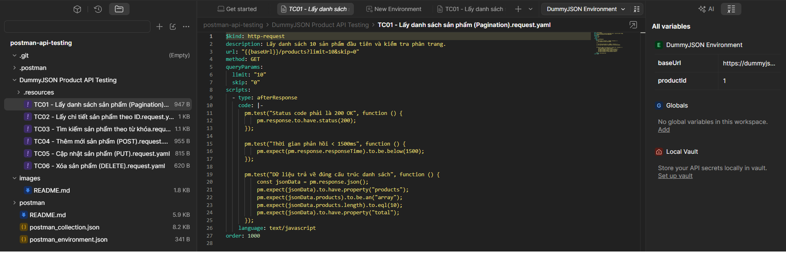
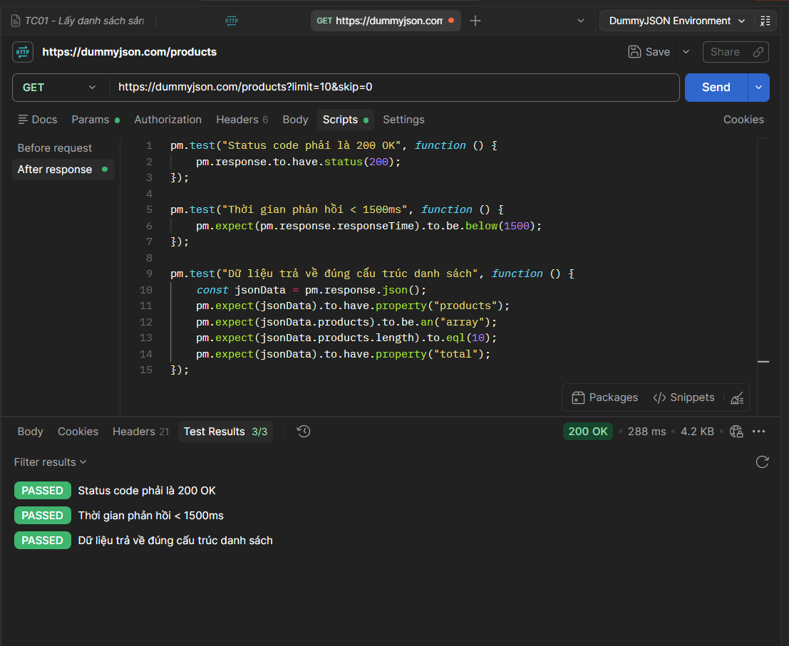
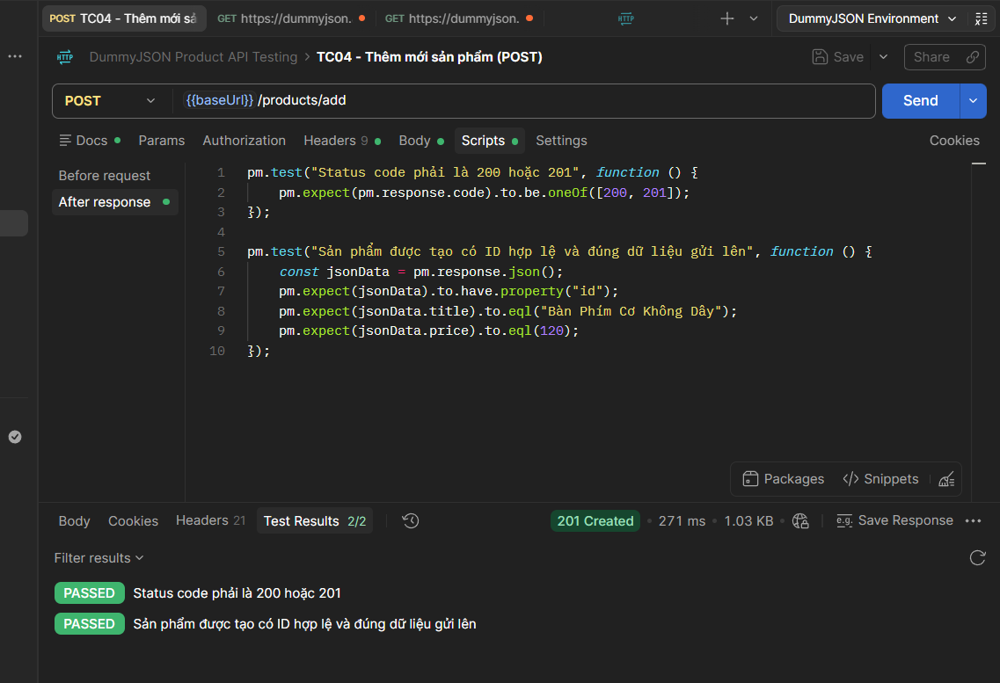
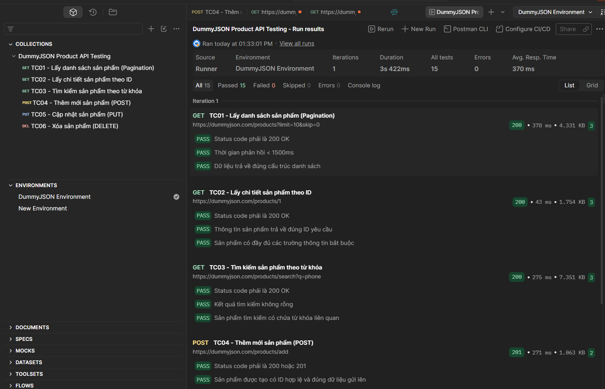

# BÁO CÁO THỰC HÀNH KIỂM THỬ API VỚI POSTMAN

## 1. Giới thiệu & Mục tiêu

* **Học phần / Đề tài:** Thực hành kiểm thử phần mềm - Kiểm thử tự động API (API Testing).
* **Công cụ sử dụng:** [Postman](https://www.postman.com/) (Desktop App).
* **Đối tượng kiểm thử:** Hệ thống REST API mô phỏng quản lý sản phẩm ([DummyJSON Products API](https://dummyjson.com/docs/products)).
* **Mục tiêu thực hiện:**
  * Nắm vững kiến thức nền tảng về kiểm thử API: HTTP Methods (`GET`, `POST`, `PUT`, `DELETE`), Headers, Request Body, Status Code.
  * Thành thạo quản lý biến môi trường (`Environment Variables`) trong Postman để tăng tính tái sử dụng.
  * Viết mã kịch bản kiểm thử tự động (`Tests Scripts`) bằng JavaScript để kiểm tra tính toàn vẹn dữ liệu, kiểu dữ liệu và thời gian phản hồi.
  * Tự động hóa chạy toàn bộ tập kiểm thử bằng tính năng **Collection Runner**.

---

## 2. Cấu trúc thư mục dự án

```text
postman-api-testing/
├── postman_collection.json    # Kịch bản kiểm thử API (6 Test Cases CRUD)
├── postman_environment.json   # Cấu hình biến môi trường (baseUrl, productId)
├── images/                    # Thư mục lưu ảnh chụp màn hình minh họa kết quả
│   ├── 01_import_collection.png
│   ├── 02_get_request_test_pass.png
│   ├── 03_post_request_test_pass.png
│   └── 04_collection_runner.png
└── README.md                  # Báo cáo chi tiết quá trình kiểm thử
```

---

## 3. Danh sách các ca kiểm thử (Test Cases)

| Mã TC | Tên ca kiểm thử | Method | Endpoint / URL | Các Assertion (Test Scripts) |
| :--- | :--- | :---: | :--- | :--- |
| **TC01** | Lấy danh sách sản phẩm | `GET` | `{{baseUrl}}/products?limit=10&skip=0` | - Status code = 200<br>- Thời gian phản hồi < 1500ms<br>- Trả về mảng `products` có 10 phần tử |
| **TC02** | Lấy chi tiết sản phẩm theo ID | `GET` | `{{baseUrl}}/products/{{productId}}` | - Status code = 200<br>- Trường `id` khớp với biến `productId`<br>- Đầy đủ các trường `title`, `price`, `category` |
| **TC03** | Tìm kiếm sản phẩm theo từ khóa | `GET` | `{{baseUrl}}/products/search?q=phone` | - Status code = 200<br>- Kết quả trả về không rỗng<br>- Tên/mô tả sản phẩm chứa từ khóa "phone" |
| **TC04** | Thêm mới sản phẩm | `POST` | `{{baseUrl}}/products/add` | - Status code = 200 hoặc 201<br>- Sản phẩm trả về có trường `id`<br>- Dữ liệu `title`, `price` khớp với Body gửi lên |
| **TC05** | Cập nhật thông tin sản phẩm | `PUT` | `{{baseUrl}}/products/{{productId}}` | - Status code = 200<br>- Dữ liệu cập nhật phản hồi chính xác |
| **TC06** | Xóa sản phẩm | `DELETE` | `{{baseUrl}}/products/{{productId}}` | - Status code = 200<br>- Phản hồi có cờ `isDeleted: true` |

---

## 4. Hướng dẫn thiết lập & Chạy kiểm thử

### Bước 1: Khởi động và Import vào Postman
1. Mở ứng dụng **Postman** trên máy tính.
2. Nhấn vào nút **Import** ở góc trên cùng bên trái.
3. Kéo thả 2 tệp tin sau vào Postman:
   * `postman_collection.json`
   * `postman_environment.json`
4. Ở góc trên bên phải giao diện Postman, chọn Environment là **`DummyJSON Environment`**.


*(Hình 1: Danh sách Collection và Environment sau khi Import thành công)*

---

### Bước 2: Kiểm thử từng Request đơn lẻ (Manual Test)

#### 2.1. Kiểm thử Request GET (TC01 - Lấy danh sách sản phẩm)
* Mở request **TC01** và bấm **Send**.
* Xem kết quả tại tab **Test Results**: Cả 3 assertion đều trả về `PASS`.


*(Hình 2: Phản hồi và kết quả kiểm thử đạt 100% của TC01)*

#### 2.2. Kiểm thử Request POST (TC04 - Thêm mới sản phẩm)
* Mở request **TC04**, kiểm tra payload JSON trong tab **Body**.
* Bấm **Send** và kiểm tra kết quả tại tab **Test Results**: Hệ thống trả về mã trạng thái thành công kèm ID mới được tạo.


*(Hình 3: Kết quả kiểm thử thêm mới sản phẩm đạt yêu cầu)*

---

### Bước 3: Chạy kiểm thử tự động toàn bộ (Collection Runner)

1. Nhấp chuột phải vào Collection **`DummyJSON Product API Testing`** ở thanh điều hướng bên trái.
2. Chọn **Run collection**.
3. Giữ nguyên thứ tự các request, chọn Environment là **`DummyJSON Environment`**.
4. Nhấn nút **Run DummyJSON Product API Testing**.
5. Toàn bộ 6 test cases được thực thi tuần tự, xuất bảng tổng hợp kết quả chi tiết.


*(Hình 4: Bảng tổng kết thực thi tự động toàn bộ kịch bản kiểm thử - 100% Passed)*

---

## 5. Kết luận & Đánh giá

* **Kết quả đạt được:**
  * 100% các ca kiểm thử đều vượt qua (Passed) các tiêu chí kiểm tra (Assertions).
  * Thời gian phản hồi trung bình của API nằm trong ngưỡng an toàn cho phép (< 1.5 giây).
  * Các phương thức CRUD phản hồi đúng chuẩn RESTful API và cấu trúc schema dữ liệu.
* **Kỹ năng đã tiếp thu qua bài thực hành:**
  * Cách tổ chức API Collection và cấu hình biến môi trường Environment chuyên nghiệp.
  * Kỹ năng viết kịch bản assert dữ liệu phản hồi bằng thư viện Chai/JavaScript trên Postman.
  * Tự động hóa quy trình kiểm thử hồi quy (Regression Testing) qua Collection Runner.
